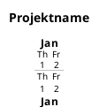
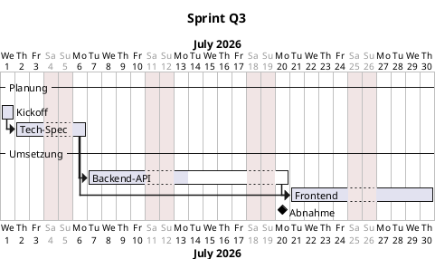

# PlantUML Gantt Renderer

> Aktuelle Version: **v26.10.2** (2026-10-26) · English version: [README.en.md](README.en.md)

Single-File-Webanwendung, die eine Teilmenge der **PlantUML-Gantt-Syntax** im Browser nativ rendert — ohne PlantUML-Server, ohne Java, ohne Backend. Live-Reload beim Editieren der `.puml`-Datei, kritischer-Pfad-Highlighting, klappbare Sections, reproduzierbarer Export, A4-Druck.

```
plantuml-renderer.html   ← die einzige Datei
```

## Features

### Render-Engine

- **Vollständig client-seitig:** PlantUML-Gantt-Subset wird direkt im Browser geparst und als SVG gerendert.
- **Live-Reload:** Polling der gewählten `.puml`-Datei alle 1 s; bei Änderung sofortiges Re-Rendering.
- **Robustes Live-Parsen:** pro-Zeile-toleranter Parser mit Heuristiken (Eckklammer-Imbalance, verdächtiges Datum, Keyword ohne Muster). Dummy-Tasks bei Syntaxfehlern verhindern, dass Nachfolger an den Projektanfang zurückspringen. Letzter erfolgreich gerenderter Stand bleibt bei Fehlern sichtbar.
- **Strukturiertes Warn-Banner** mit Zeilennummern pro Fehler. Plus Lint-Warnungen: **isolierte Items** (kein Vorgänger, kein Nachfolger, keine Abhängigkeit) und **Plan-Konflikte** (Vorgänger endet nach Nachfolger-Start, bei FS-Beziehungen).
- **Source-Preview** im Panel mit rot markierten Fehlerzeilen, automatisch eingeblendet bei Problemen.

### Visualisierung

- **Kritischer Pfad** (CPM, Slack=0) per Toggle: rote Outline um kritische Bars/Milestones, rote Kanten auf den Pfeilen entlang der Kette. Manuelle Bar-Farben bleiben unangetastet (Outline-Frame außerhalb des Balkens). Backward-Pass ist **Lag-aware** (Offsets in `+ N days` propagieren Slack korrekt) und unterscheidet **hard edges** (`afterTask`, verschieben den Nachfolger) von **soft edges** (`->`-Pfeile, nur logische Reihenfolge). SS-Beziehungen (`at [Y]'s start + N`) werden korrekt als Parallel-Beziehung behandelt. Pro zusammenhängender Abhängigkeitskomponente wird nur die längste (slack-freie) Kette markiert — kürzere Seitenketten und isolierte Tasks mit spätem Enddatum bleiben unmarkiert.
- **Zeitachse adaptiv:** Year / Quarter / Month / KW / Datum / Projekttag / Wochentag je nach Zoomstufe. Das Year-Label wird bei breiten Year-Ticks alle ~500 px wiederholt, damit es bei horizontalem Scrollen immer ablesbar bleibt.
- **100%-Zoom-Button:** setzt die Skala einmalig auf `BAR_H` px/Tag (= 14) — konstanter Wert, unabhängig von Datums-Filter oder Browser-Breite. Für reproduzierbaren Export: gleiche `.puml` + gleicher Datums-Filter + 100%-Zoom → identischer Output.
- **Sticky-Header & Sticky-Label-Spalte** beim Scrollen.
- **Dynamische Label-Spalte:** automatische Breite zwischen 200–500 px je nach längstem Task-Namen.
- **Heute-Linie**, **Wochenend-/Feiertags-Shading**, **Progress-Overlay** (`is N% completed`), **Custom-Farben** (`is colored in #hex/TextColor`).
- **Sections einklappbar:** Klick auf Section-Header oder Buttons "Alle einklappen" / "Alle ausklappen".
- **Notizen** in der rechten Notiz-Spalte. Mehrzeilig via `note bottom` + `end note`-Block, hängt automatisch am vorhergehenden Task/Milestone.
- **Projektanfang implizit:** Wenn `Project starts` in der `.puml` fehlt, leitet der Renderer den Anfang aus dem frühesten Task/Milestone ab → `T+N`-Skala funktioniert auch ohne explizite Direktive.

### Bedienung

- **Datums-Filter** (Von / Bis) als manuelle Override; "Auto" resettet auf autoWindow + skaliert auf Browser-Breite (sticky, neu fitten bei Panel-Collapse, Splitter-Drag, Window-Resize).
- **Zoom** per Buttons (+/−) oder Strg+Mausrad (Cursor-fokussiert).
- **Tooltips** auf Bars/Milestones/Notes (XSS-sicher via DOM-API). Bei Tasks: Start, Ende, Dauer (Tage/Wochen), Fortschritt (`is N% completed > 0`), direkte Vorgänger und Nachfolger (mit Anzeige-Labels aus `[Display] as [alias]`). Bei Milestones: Datum + Vorgänger/Nachfolger. Notiz-Text erscheint auch dann im Hover-Tooltip, wenn der „Notizen anzeigen"-Toggle aus ist.
- **Interaktives Hervorheben:** Hover über eine Bar/Milestone hebt alle ein- und abgehenden Abhängigkeitspfeile hervor (Amber); Hover über einen Pfeil hebt die Linie hervor (Türkis). Ein Klick friert die Auswahl ein (**Pin-Modus**) — der Tooltip ist dann unterdrückt; ein zweiter Klick oder `ESC` löst den Pin wieder.
- **Tastatur:** Section-Header und Bars/Milestones sind per `Tab` erreichbar — `Enter`/`Leertaste` klappt eine Section ein/aus, Fokus auf eine Bar/Milestone zeigt denselben Tooltip wie Hover. Abhängigkeitspfeile bleiben maus-only.
- **Toggles:** Meilensteine, Notizen, Abhängigkeiten, Kritischer Pfad, Auto-Reload.
- **Ansicht-Buttons:** `100%` (fixer Zoom auf 14 px/Tag, für reproduzierbaren Export) und `Auto` (sticky Resize-Fit + Datums-Fenster auf alle Tasks).

### Export

- **SVG** (vektoriell, beliebig nachbearbeitbar).
- **PNG** (4× Supersampling).
- **PDF / Drucken A4 Quer** (mit eingebetteter Source-Sans-3 für schriftgenauen Druck).
- **HTML** — eigenständige, interaktive Datei mit fest eingebettetem Diagramm für die Weitergabe ohne Ordnerzugriff (kein PlantUML-Server, kein Backend nötig). Ordner-/Dateiauswahl, Neu laden, Auto-Reload und der Export-HTML-Button selbst sind darin ausgeblendet (Re-Export eines bereits statischen Exports ergibt keinen Sinn); SVG/PNG/PDF-Export, Zoom, Datums-Filter und Toggles bleiben nutzbar und übernehmen den Stand zum Export-Zeitpunkt. Ein Hinweistext markiert die Datei als statischen Snapshot.

### Persistenz

- IndexedDB cached den zuletzt gewählten Ordner-Handle (kein Re-Picken nach Reload) und die eingebettete Druck-Font.
- **Keine eingebaute Versionierung** — siehe [Versionierung](#versionierung).

---

## Installation & Start

### Bootstrap (macOS/Linux, empfohlen)

Ein Befehl für Installation **und** Update — klont nach `~/.local/share/plantuml-renderer` bzw. aktualisiert eine bestehende Installation per `git pull`:

```bash
curl -fsSL https://raw.githubusercontent.com/jcmx9/plantuml-renderer/main/scripts/install.sh | bash
```

Anderes Zielverzeichnis: `PLANTUML_RENDERER_DIR=/pfad/zum/ziel` vor `bash` setzen (`… | PLANTUML_RENDERER_DIR=/pfad bash`). Voraussetzung: `git`.

Starten (lokaler Python-Webserver im Installationsverzeichnis, öffnet den Browser):

```bash
~/.local/share/plantuml-renderer/scripts/serve.sh            # Port 8000
PORT=8080 ~/.local/share/plantuml-renderer/scripts/serve.sh  # anderer Port
```

Der Server lauscht nur auf `127.0.0.1`; beenden mit Strg+C. Voraussetzung: `python3`.

### Holen via Git (manuell — Updates per `git pull`)

```bash
# einmalig klonen (in den aktuellen Pfad; Verzeichnis sollte leer sein)
git clone https://github.com/jcmx9/plantuml-renderer.git .
# alternativ SSH: git clone git@github.com:jcmx9/plantuml-renderer.git .

# später aktualisieren
git pull
```

### Alternative: Direkt-Download

Letztes Release-Asset (`plantuml-renderer.html`) von [github.com/jcmx9/plantuml-renderer/releases/latest](https://github.com/jcmx9/plantuml-renderer/releases/latest) herunterladen — keine weiteren Dateien nötig. Direkter Link auf die jeweils aktuelle Datei:

```bash
curl -fLO https://github.com/jcmx9/plantuml-renderer/releases/latest/download/plantuml-renderer.html
```

```powershell
Invoke-WebRequest https://github.com/jcmx9/plantuml-renderer/releases/latest/download/plantuml-renderer.html -OutFile plantuml-renderer.html
```

> **Achtung:** Nicht die GitHub-Ansicht der Datei (`github.com/…/blob/main/plantuml-renderer.html`) per „Seite speichern unter" sichern — das speichert die GitHub-Webseite (mehrere MB, voller `<link rel="dns-prefetch">`/`modulepreload`-Elemente) statt des Renderers. Lokal geöffnet lädt sie massenhaft GitHub-Ressourcen nach und endet in *„Whoa there! You have triggered an abuse detection mechanism."* Die echte Datei ist ca. 160 KB groß und beginnt mit `<!DOCTYPE html>` / `<html lang="de">`.

---

### Variante 1: Doppelklick (einfachste Form)

```bash
open plantuml-renderer.html      # macOS
xdg-open plantuml-renderer.html  # Linux
start plantuml-renderer.html     # Windows
```

Funktioniert mit Einschränkung: die File-System-Access-API (`showDirectoryPicker`) kann je nach Browser-Version per `file://`-Aufruf blockiert sein.

### Variante 2: Lokaler Python-Webserver (empfohlen)

```bash
python3 -m http.server 8000
```

Dann im Browser öffnen:

```
http://localhost:8000/plantuml-renderer.html
```

Vorteile:

- File-System-Access-API funktioniert zuverlässig.
- Source-Sans-3-Font lädt sauber von Google Fonts.
- IndexedDB-Origin ist stabil (`http://localhost:8000`) — Persistenz bleibt zwischen Sessions.

**Browser-Anforderung:** Chromium-basiert (Chrome ≥ 86, Edge, Brave, Arc, Vivaldi). **Safari & Firefox** unterstützen `showDirectoryPicker` nicht — Ordner-Watch funktioniert dort nicht.

### Erste Schritte

1. Browser öffnen, App laden.
2. **"Ordner wählen"** klicken → Verzeichnis mit `.puml`-Dateien auswählen.
3. Datei aus dem Dropdown wählen.
4. Im Editor (z. B. VSCodium, VSCode, Vim) die `.puml`-Datei editieren und speichern → App rendert binnen 1 s neu.

---

## Kurzreferenz

### Pflichtrahmen



### Nicht-Arbeitstage

```puml
saturday are closed
sunday are closed
```

### Tasks

| Schlüsselwort | Beispiel |
|---|---|
| Absoluter Start + Dauer | `[Name] starts 2026-01-05 and lasts 5 days` |
| Absoluter Start + Ende | `[Name] starts 2026-01-05 and ends 2026-01-10` |
| Nur Dauer (ab `Project starts`) | `[Name] lasts 3 days` |
| Relativ zu Vorgänger | `[B] starts at [A]'s end and lasts 2 days` |
| Mit Offset | `[B] starts at [A]'s end + 2 days and lasts 5 days` |
| Direkte Nachfolge | `then [Name] lasts 3 days` |
| Alias (Referenzschlüssel) | `[Langer Name] as [alias] lasts 1 week` |

> `lasts` und `requires` sind Synonyme.

### Meilensteine

```puml
[M] happens 2026-06-30
[M] happens at [Task]'s end
[M] happens at [Task]'s end + 5 days
[M] happens on 3 days after [Task]'s end
```

### Abhängigkeitspfeile

```puml
[A] -> [B]
```

Zeigt einen visuellen Pfeil; verschiebt **kein** Datum. Für echte Terminabhängigkeit `starts at [A]'s end` verwenden.

### Modifier

```puml
[Task] is colored in #2980b9
[Task] is colored in #2980b9/white
[Task] is 75% completed
```

### Gliederung & Kommentare

```puml
-- Phase 1 --
-- Detail [2] --
' Einzeiliger Kommentar
/' Block-
   Kommentar '/
```

### Notizen

```puml
[Task] lasts 3 days
note bottom
Erste Zeile.
Zweite Zeile.
end note
```

### Minimalbeispiel



---

## PlantUML-Syntax-Referenz

Diese Tabelle zeigt **alle Konstrukte, die der Renderer unterstützt**. Alles, was hier nicht steht, wird stillschweigend ignoriert oder als Warnung gemeldet. Die Reihenfolge entspricht dem Layout im Chart (Source-Order = Zeilen-Order).

### Projekt-Rahmen

| Syntax                                  | Wirkung                                                                      |
| --------------------------------------- | ---------------------------------------------------------------------------- | --- | -------------------------------------------- |
| `@startgantt` / `@enduml` / `@endgantt` | Diagramm-Klammer (ignoriert, akzeptiert für PlantUML-Kompatibilität).        |
| `title Projektbezeichnung`              | Titel oben in der Label-Spalte des SVG-Headers.                              |
| `Project starts 2026-01-01`             | Anker für `[X] lasts N days`-Tasks und für die Projekttag-Skala (`T1, T2…`). |
| `saturday are closed`                   | Wochentag als Nicht-Arbeitstag (`monday                                      | …   | sunday`). Wird in`addWorkDays` übersprungen. |
| `2026-12-25 is closed`                  | Einzelner Kalendertag als Nicht-Arbeitstag (gleiches Verhalten).             |
| `2026-12-24 to 2026-12-26 are closed`   | Datums-Bereich als Nicht-Arbeitstage (Range expandiert in `closedDates`).    |
| `2026-05-23 is open`                    | Reopen-Override: einzelner Tag bleibt offen, auch wenn z. B. `saturday are closed` greift. |

### Tasks

| Syntax                                                      | Bedeutung                                          |
| ----------------------------------------------------------- | -------------------------------------------------- |
| `[Name] starts 2026-01-01 and ends 2026-01-10`              | Absolute Start- und End-Daten; der Endtag zählt mit (wie in PlantUML). |
| `[Name] starts 2026-01-01 and lasts 5 days`                 | Absoluter Start + Dauer (Arbeitstage).             |
| `[Name] starts 2026-01-01 and lasts 2 weeks`                | Dauer in Wochen (= 14 Tage).                       |
| `[Name] requires 1 week and 4 days`                         | Compound-Duration (= 11 Tage; PlantUML-Doku-Standard). |
| `[A] requires 5 days then [B] requires 3 days`              | Single-Line-Chaining: zwei Tasks in einer Zeile.   |
| `[A] requires 5 days then` (mit Folge-Zeile)                | Multi-Line-Succession: `then` am Zeilenende, nächste Zeile ist Nachfolger. |
| `[Name] starts D+5 and requires 3 days`                     | `D+n`-Notation: relative zu `Project starts` (D+0). |
| `[Name] ends D+10 and requires 2 days`                      | `D+n` auch im `ends`-Kontext.                       |
| `[Name] ends 2026-07-15`                                    | Standalone-`ends` — Start ergibt sich aus Default-Dauer 1. |
| `[Name] ends 2026-07-20 and requires 5 days`                | `ends`-Anker mit Dauer: Start rückwärts berechnet.  |
| `[Span] occurs from [M1] to [M2]`                           | Task-Span zwischen zwei Milestones (oder Tasks).    |
| `[Name] lasts 5 days`                                       | Implizit ab `Project starts`.                      |
| `then [Name] lasts 3 days`                                  | Beginnt direkt nach dem zuletzt definierten Task.  |
| `[Name] starts at [Other]'s end and lasts 3 days`           | Relative Abhängigkeit auf das Ende von `[Other]`.  |
| `[Name] starts at [Other]'s end + 2 days and lasts 5 days`  | Mit Offset (`+ N days/weeks`).                     |
| `[Name] starts at [Other]'s start and lasts 4 days`         | Beginnt zeitgleich mit `[Other]`.                  |
| `[Name] starts 3 days after [Other]'s end and lasts 2 days` | Alternative Schreibweise mit `N days/weeks after`. Offset **kalendarisch** (PlantUML-Spec). |
| `[Name] starts 3 working days after [Other]'s end and lasts 2 days` | Wie zuvor, aber Offset zählt nur Arbeitstage (überspringt closed-Tage). |
| `[Name] starts at [Other]'s end and ends 2026-04-30`        | Mischung relativ-/absolut-Ende.                    |
| `[Name] starts 1 day before [Other]'s start`                | Backward-Constraint (relativer Start vor Pivot).   |
| `[Name] starts 2 days before [Other]'s end and lasts 5 days` | Backward + Dauer.                                  |
| `[Name] requires 5 days and ends at [Other]'s end`          | Dauer + End-Anker (Start rückwärts berechnet).     |
| `[Name] starts 1 day before [Y]'s start and ends at [Y]'s end` | Start- und End-Anker kombiniert (Doku-Beispiel). |

> **Synonym:** `requires` ist überall ein 1:1-Ersatz für `lasts` (PlantUML-Doku-Standard). Beispiel: `[Name] requires 5 days` ≡ `[Name] lasts 5 days`.

### Meilensteine

| Syntax                                     | Bedeutung                        |
| ------------------------------------------ | -------------------------------- |
| `[Done] happens 2026-06-30`                | Milestone an absolutem Datum.    |
| `[Done] happens at [X]'s end`              | Am Ende eines Tasks.             |
| `[Done] happens at [X]'s end + 5 days`     | Mit positivem Offset.            |
| `[Done] happens at [X]'s start`            | Am Anfang eines Tasks.           |
| `[Done] happens on 3 days after [X]'s end` | Alternative Offset-Schreibweise. |
| `[Kickoff] happens on 5 days before [X]'s start` | Backward-Form (PlantUML-doku-belegt, nur für Milestones). |

### Abhängigkeitspfeile

| Syntax       | Bedeutung                                                                                                                                                      |
| ------------ | -------------------------------------------------------------------------------------------------------------------------------------------------------------- |
| `[A] -> [B]` | Visueller Pfeil von Task A nach Task B im Chart; zusätzlich CPM-Kante. Verschiebt **kein** Datum. Für echte Constraints `[B] starts at [A]'s end …` verwenden. |

### Modifier (auf zuletzt definiertes Item)

| Syntax                                 | Bedeutung                                                                                                                               |
| -------------------------------------- | --------------------------------------------------------------------------------------------------------------------------------------- |
| `[A] is colored in #2980b9`            | Bar-/Diamond-Fill. Hex-Farbe.                                                                                                           |
| `[A] is colored in #2980b9/white`      | Fill plus Textfarbe (`/` als Trenner).                                                                                                  |
| `[A] is 75% completed`                 | Progress-Overlay (halbtransparenter dunkler Block auf der Bar).                                                                         |
| `[A] links to [[https://example.com]]` | Hyperlink auf Bar/Milestone und Label-Spalten-Text. Öffnet im neuen Tab. **Doppelte** eckige Klammern um die URL (PlantUML-Konvention). |
| `[B] displays on same row as [A]` | Task/Milestone B teilt sich die Y-Zeile mit A (kein eigenes Label, eigene Bar). |
| `[A] pauses on 2026-06-15`             | Pause-Tag (PlantUML-Direktive). Task-Ende verschiebt sich um die Pause-Tage nach hinten. |
| `[A] pauses on monday`                 | Pause-Wochentag — alle Vorkommen werden im Task-Zeitraum übersprungen. |

### Strukturierung

| Syntax                          | Bedeutung                                                                                        |
| ------------------------------- | ------------------------------------------------------------------------------------------------ |
| `-- Phase 1 --`                 | Section-Header (dunkler Balken über volle Breite). **Klickbar** → ein-/ausklappbar.              |
| `-- Detail [2] --`              | Subsection (heller Balken, schmaler Akzent). Nicht klickbar, aber wird mit Section ausgeblendet. |
| `[Display] as [alias] starts …` | Alias-Trick: `[alias]` ist die referenzierbare ID, `Display` der angezeigte Label-Text.          |

### Kommentare (intern, nicht gerendert)

| Syntax                       | Bedeutung                                                                             |
| ---------------------------- | ------------------------------------------------------------------------------------- |
| `' Kommentar bis Zeilenende` | Einzeiliger Code-Kommentar (PlantUML-Konvention). Hat keinen Einfluss auf den Render. |
| `/' Block-Kommentar '/`      | Mehrzeiliger Block-Kommentar; alles dazwischen wird ignoriert.                        |

### Diagramm-Notizen (im Chart sichtbar)

| Syntax                            | Bedeutung                                                                                                                                                                                                                                 |
| --------------------------------- | ----------------------------------------------------------------------------------------------------------------------------------------------------------------------------------------------------------------------------------------- |
| `note bottom` `…Text…` `end note` | Mehrzeilige Notiz nach einem Task/Milestone. Hängt automatisch am zuletzt definierten Task/Milestone, wird in der rechten Notiz-Spalte als erste Zeile + `…` gerendert; der Tooltip beim Hover zeigt den vollen Text mit Zeilenumbrüchen. |

### Tipps zur Praxis

- **Source-Order zählt.** Tasks erscheinen in der Reihenfolge, in der sie geschrieben werden. Sections gruppieren visuell, ändern aber keine Datums-Logik.
- **Aliasse für lange Namen:** `[Implementierung der Auth-Komponente] as [auth] starts …` macht spätere Referenzen kurz.
- **Implizit-temporal:** Tasks ohne `afterTask` aber mit absolutem Datum werden im **kritischen Pfad** automatisch dem in der Source-Ordnung letzten Vorgänger angehängt, dessen `end ≤ start` ist. So bleibt der CP auch bei Datums-Tasks aussagekräftig.

---

## Versionierung

Der Renderer hat **keine** eingebaute Snapshot-/History-Funktion. Versionsverwaltung läuft extern:

1. `.puml`-Ordner mit `git init` zum Repo machen.
2. In einem Editor mit Git-Panel arbeiten — **VSCodium** (FOSS-Build von VSCode, mit PlantUML-Extension + eingebauter Source-Control-Tab), VSCode oder JetBrains IDEs sind alle geeignet.
3. Beim Speichern committen wenn Meilenstein erreicht; `git push` für Backup/Sync.
4. Alte Version anschauen: `git checkout <commit> -- file.puml` → Renderer pollt, rendert automatisch.

Diese Trennung "Renderer = View, Git = Verwalter" hält den Renderer schlank und nutzt etablierte Tools.

---

## Beispiel-Datei

Im Repo liegt [`example.puml`](example.puml) — ein vollständiges Sprint-Beispiel mit parallelen Streams, das praktisch jede unterstützte Syntax-Form einmal zeigt: Section + Subsection, Alias-Form, absolute und relative Task-Constraints, mehrere Milestone-Varianten, `then`-Form, `->`-Pfeile, `is N% completed` / `is colored in #hex/textColor`-Modifier, Code- und Block-Kommentare sowie eine mehrzeilige `note bottom`-Notiz.

Lade die Datei im Renderer, aktiviere „Kritischen Pfad hervorheben" → die längste Pfadkette (Discovery → QA → Release) ist rot umrandet, die parallelen Streams (Auth-Middleware, Migration) bleiben unmarkiert.

---

## Browser-Kompatibilität

| Browser               | Status           | Anmerkung                                          |
| --------------------- | ---------------- | -------------------------------------------------- |
| Chrome ≥ 86           | ✅ vollständig   | empfohlen                                          |
| Edge (Chromium)       | ✅ vollständig   |                                                    |
| Brave / Arc / Vivaldi | ✅ vollständig   |                                                    |
| Firefox               | ⚠️ eingeschränkt | kein `showDirectoryPicker`, manueller Reload nötig |
| Safari                | ⚠️ eingeschränkt | wie Firefox                                        |

---

## Lizenz

MIT — siehe [LICENSE](LICENSE).
